# Сверка 15 значений с источниками

Для веб-страниц снимок показывает фрагмент сохранённого ответа сайта, для PDF фрагмент документа.

| № | Фонд | Дата | Показатель | Наше значение | В источнике | Совпало | Снимок | Источник |
|---|---|---|---|---|---|---|---|---|
| 1 | ОПИФ рыночных финансовых инструментов «ААА Сбалансированный» | 04.09.2026 | СЧА | 11474536.02 | 11 474 536,02 ₽ | да | 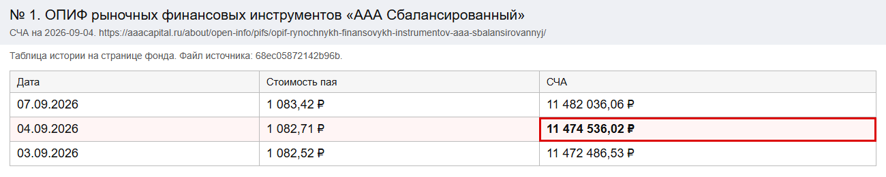 | [Открыть](https://aaacapital.ru/about/open-info/pifs/opif-rynochnykh-finansovykh-instrumentov-aaa-sbalansirovannyj/) |
| 2 | ОПИФ рыночных финансовых инструментов «ДОХОДЪ. Будущее 2035» | 30.09.2026 | СЧА | 10300000.00 | 10,30 млн. руб. | да | 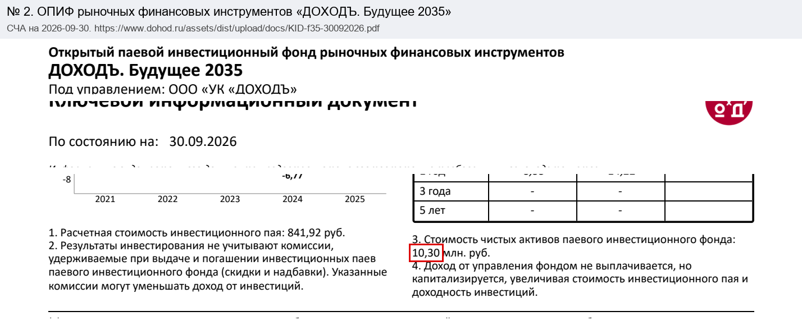 | [Открыть](https://www.dohod.ru/assets/dist/upload/docs/KID-f35-30092026.pdf) |
| 3 | ОПИФ рыночных финансовых инструментов «Первая - Устойчивый портфель Зима» | 16.10.2026 | Пай | 151.576 | 151.576 | да | 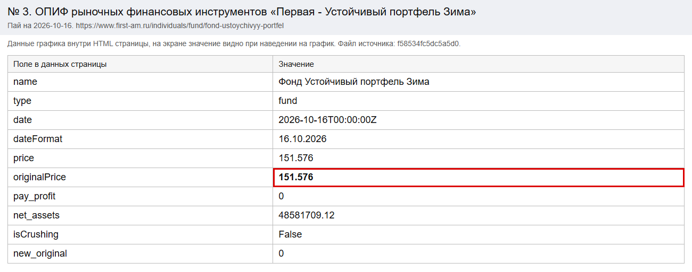 | [Открыть](https://www.first-am.ru/individuals/fund/fond-ustoychivyy-portfel) |
| 4 | ОПИФ рыночных финансовых инструментов «Альфа - Капитал Сбалансированный с выплатой дохода» | 29.10.2026 | Пай | 1254.42 | 1254.42 | да | 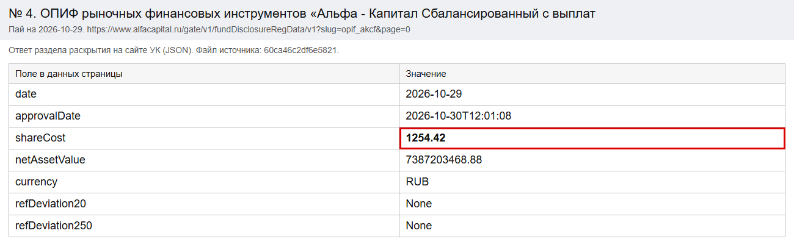 | [Открыть](https://www.alfacapital.ru/gate/v1/fundDisclosureRegData/v1?slug=opif_akcf&page=0) |
| 5 | БПИФ рыночных финансовых инструментов "ДОХОДЪ. Облигации до декабря 2026/2029/2032" | 30.09.2026 | Пай | 1328.03 | 1328,03 руб. | да | 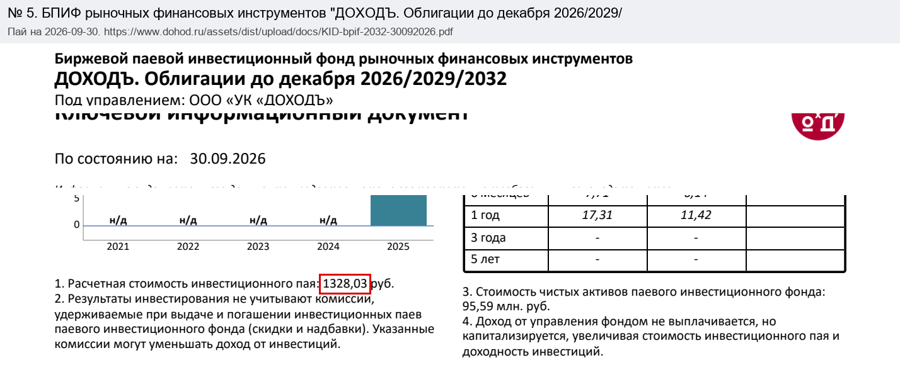 | [Открыть](https://www.dohod.ru/assets/dist/upload/docs/KID-bpif-2032-30092026.pdf) |
| 6 | ОПИФ рыночных финансовых инструментов "КМ Меркури" | 30.04.2026 | СЧА | 13031480.65 | 13 031 480,65 руб. | да | 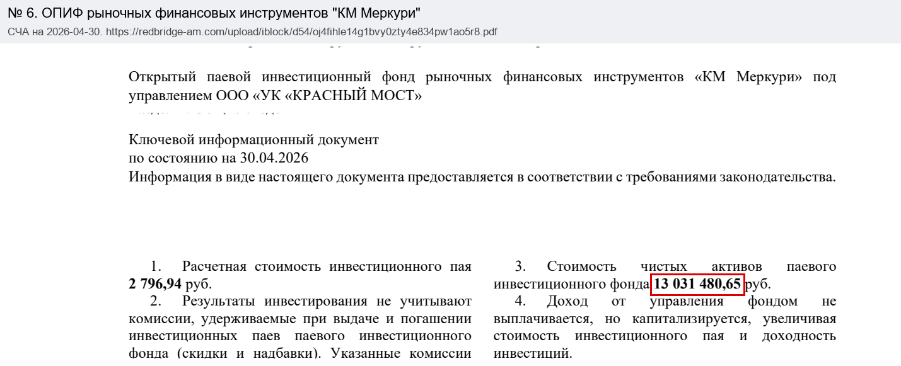 | [Открыть](https://redbridge-am.com/upload/iblock/d54/oj4fihle14g1bvy0zty4e834pw1ao5r8.pdf) |
| 7 | БПИФ рыночных финансовых инструментов «Первая - Фонд Корпоративные облигации» | 09.09.2026 | Пай | 19.1 | 19.1 | да | 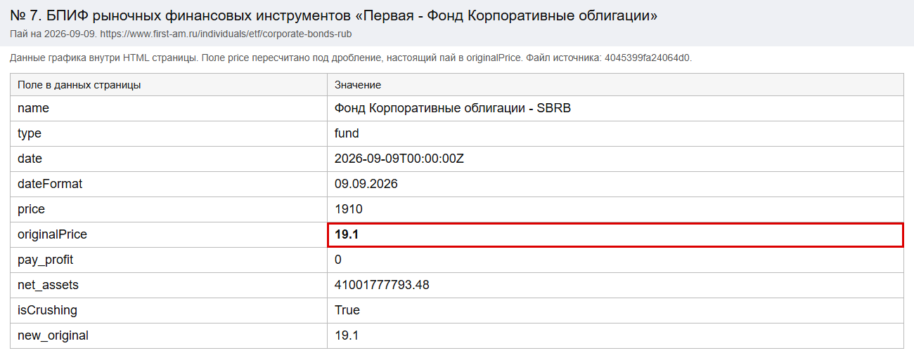 | [Открыть](https://www.first-am.ru/individuals/etf/corporate-bonds-rub) |
| 8 | БПИФ рыночных финансовых инструментов «АТОН – Флоатеры» | 31.07.2026 | Пай | 137.6215 | 137,6215 руб. | да | 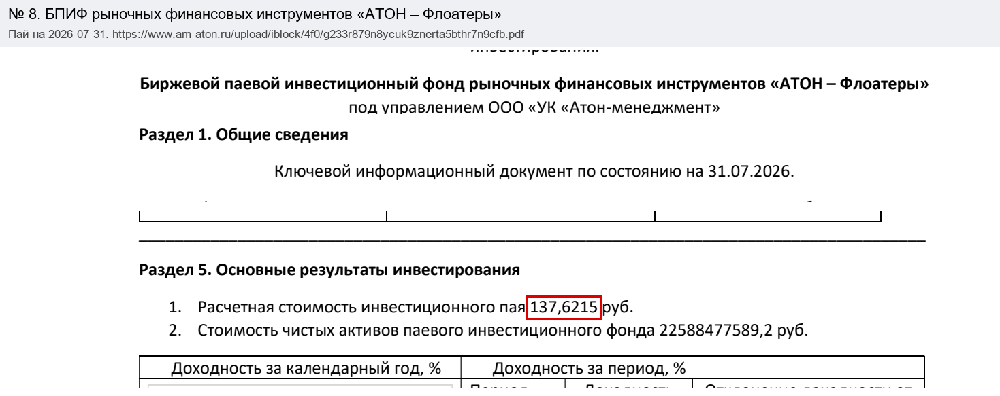 | [Открыть](https://www.am-aton.ru/upload/iblock/4f0/g233r879n8ycuk9znerta5bthr7n9cfb.pdf) |
| 9 | ОПИФ рыночных финансовых инструментов «Ренессанс Жизнь – Разумные инвестиции» | 11.08.2026 | Пай | 102.8451 | 102.8451 | да | 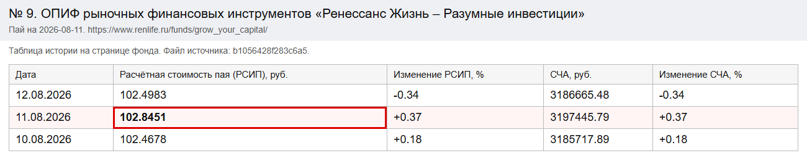 | [Открыть](https://www.renlife.ru/funds/grow_your_capital/) |
| 10 | ОПИФ рыночных финансовых инструментов «Маркет Пауэр - Акции» | 20.08.2026 | Пай | 136.43 | 136,43 | да | 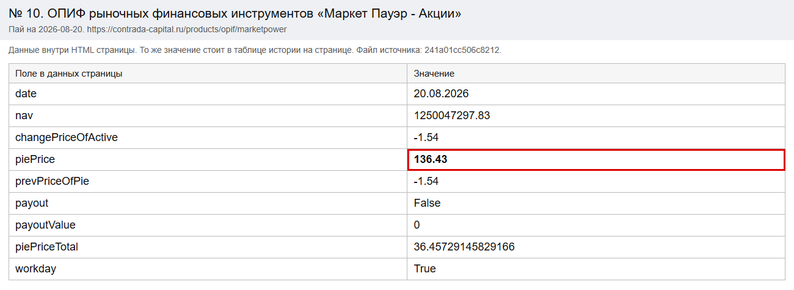 | [Открыть](https://contrada-capital.ru/products/opif/marketpower) |
| 11 | ИПИФ финансовых инструментов «2х ОФЗ» | 21.08.2026 | Пай | 139383.03 | 139383.03 | да | 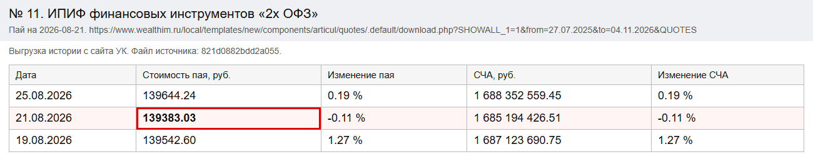 | [Открыть](https://www.wealthim.ru/local/templates/new/components/articul/quotes/.default/download.php?SHOWALL_1=1&from=27.07.2025&to=04.11.2026&QUOTES_IBLOCK_TYPE=vtb_am_fonds&QUOTES_IBLOCK_ID=25&FOND_ID=26746978&FONDS_IBLOCK_TYPE=vtb_am_fonds&FONDS_IBLOCK_ID=19) |
| 12 | ИПИФ рыночных финансовых инструментов «ОЗ – Три Кита» | 30.06.2026 | СЧА | 23720000.00 | 23,72 млн. руб. | да | 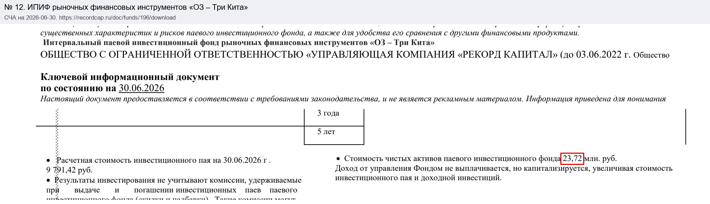 | [Открыть](https://recordcap.ru/doc/funds/196/download) |
| 13 | ОПИФ рыночных финансовых инструментов «ВИМ - Сбалансированный» | 30.01.2026 | СЧА | 10294557095.86 | 10 294 557 095,86 руб. | да | 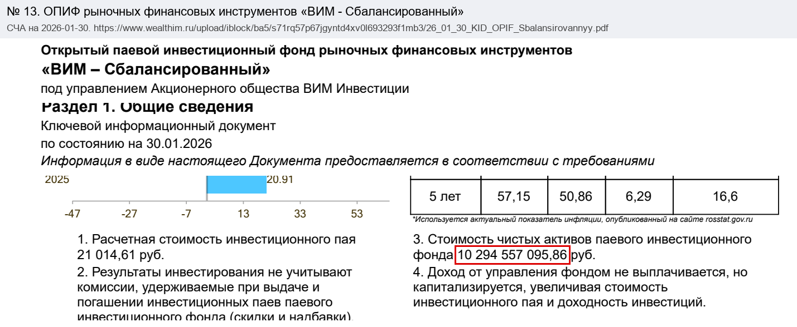 | [Открыть](https://www.wealthim.ru/upload/iblock/ba5/s71rq57p67jgyntd4xv0l693293f1mb3/26_01_30_KID_OPIF_Sbalansirovannyy.pdf) |
| 14 | ОПИФ рыночных финансовых инструментов «РЕГИОН Мультивалютный доход» | 30.04.2026 | Пай | 585.70 | 585,70 руб. | да | 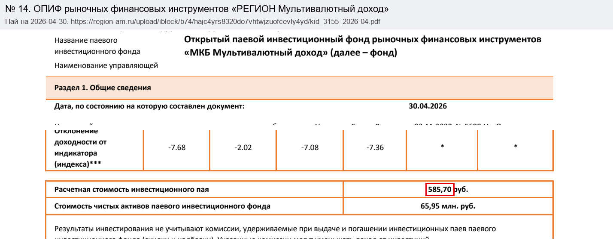 | [Открыть](https://region-am.ru/upload/iblock/b74/hajc4yrs8320do7vhtwjzuofcevly4yd/kid_3155_2026-04.pdf) |
| 15 | БПИФ рыночных финансовых инструментов «АТОН – Накопительный в юанях» | 30.09.2025 | СЧА | 324770060.33 | 324770060,33 CNY | да | 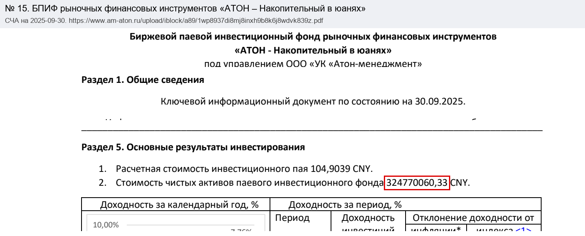 | [Открыть](https://www.am-aton.ru/upload/iblock/a89/1wp8937di8mj8inxh9b8k6j8wdvk839z.pdf) |
