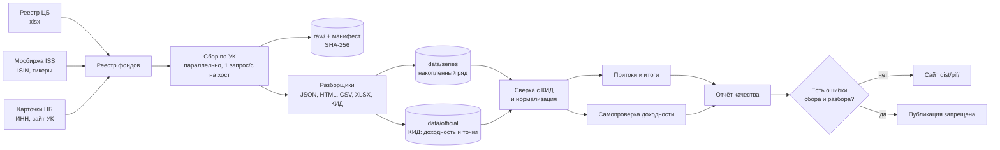

# Архитектура

## Коротко

Это пакетный конвейер, а не сервис. Он запускается одной командой, ходит по первичным источникам,
складывает сырые файлы, приводит данные к одному виду, считает притоки, проверяет себя и собирает
статический сайт. Во время работы сайта нет ни сервера, ни базы.

## Модули

| Модуль | За что отвечает |
|---|---|
| `pif/registry` | Реестр ЦБ, Мосбиржа, карточки УК, связка с разделом «Сравнить УК» |
| `pif/net` | Вежливый HTTP-клиент: лимит на хост, robots.txt, условные запросы, ретраи |
| `pif/storage` | Сырые файлы по SHA-256, манифест, накопленные ряды |
| `pif/parsers` | Разборщики. Ничего не знают о сайтах, получают байты и возвращают строки ряда |
| `pif/adapters` | Где лежат данные конкретной УК. Разбирать ничего не умеют |
| `pif/matching` | Сопоставление названий с реестром |
| `pif/normalize` | Дробления, выбросы, единицы, валюта, пропуски, сверка с КИД |
| `pif/flows` | Притоки и итоги по разрезам |
| `pif/verify` | Сверка доходности с официальной |
| `pif/analytics.py` | Собирает всё в витрину и отчёт качества |
| `pif/site` | Статический сайт на Jinja2, графики в SVG |
| `pif/observability` | Логи и трассировка |
| `config/sources.yaml` | Где искать данные каждой УК |
| `config/known_issues.yaml` | Разобранные вручную ошибки, которые не останавливают публикацию |

Новая УК обычно добавляется строкой в `config/sources.yaml`. Новый адаптер нужен только там, где
данные отдаёт собственный API.

## Почему так

**Два источника на каждый фонд.** Дневные ряды у всех разные, а КИД один на всех: шаблон задан
Банком России. Поэтому КИД решает сразу три задачи: это запасной источник месячных точек, источник
официальной доходности и независимая проверка дневного ряда. КИД сам называет фонд, поэтому он
сильнее привязки страницы к фонду по заголовку. Если дневной ряд не сходится с КИД, ряд отбрасывается.

**Асинхронность вместо брокера.** Работа упирается в лимит один запрос в секунду на хост, а не в
процессор. `asyncio` даёт параллельность между хостами: пока один сайт ждёт свою секунду, другие
работают. Брокер (RabbitMQ, Kafka) здесь ничего не добавил бы, а одна команда превратилась бы в
docker-compose из нескольких сервисов. Очередь живёт один прогон, задача не требует гарантий
доставки между процессами, а устойчивость даёт состояние на диске: после обрыва прогон продолжается
с контрольной точки. Брокер понадобится, если сбор разойдётся по нескольким машинам.

**Пул процессов для PDF.** Разбор PDF занимает процессор и внутри `asyncio` останавливал бы сеть. Поэтому документы
разбираются в `ProcessPoolExecutor`, а результат кэшируется по SHA-256: КИД не меняется, и повторный прогон его не разбирает.

**Файлы вместо базы.** Сайт статический, объём маленький (сотни тысяч точек). CSV в git дают
историю изменений каждой точки и простую проверку глазами. В задании прямо сказано: сбор и расчёты
идут отдельно, база во время работы не нужна.

**Decimal вместо float.** Суммы по фондам обязаны сходиться с итогами копейка в копейку. Сверка
в `check_tie_out` сравнивает их на точное равенство, без допуска.

**Сайт без фреймворка.** Страницы всё равно должны приходить готовым HTML. Генератор на Jinja2 и
SVG-графики дают это без Node, сборщика и внешних библиотек графиков. Лицензии и размер сборки
от этого только выигрывают.

## Логи и трассировка

Логи структурные: в консоль человекочитаемо, в `out/logs/<run_id>.jsonl` как JSON. К каждой записи
прикреплены `run_id`, `trace_id` и `span_id`.

Трассировка на OpenTelemetry. Дерево спанов: `pipeline` → `collect` → `collect.uk` →
`adapter.crawl` → `http.fetch`. Спаны всегда пишутся в `out/traces/<run_id>.jsonl`. Если задать
`OTEL_EXPORTER_OTLP_ENDPOINT` и поставить extra `otlp`, они уйдут в Jaeger или Tempo.

Так можно понять, почему прогон шёл долго: посмотреть, какая УК заняла больше времени и на каком
запросе.

## Устойчивость

| Ситуация | Что происходит |
|---|---|
| Сайт не отвечает | Ретраи с паузой, затем статус «Сайт УК недоступен». Прогон идёт дальше |
| 403, 429, капча | Статус «Сайт блокирует доступ». Обхода нет |
| Сайт закрыт в robots.txt | Страницы не запрашиваются, статус с причиной |
| Незнакомый формат | `UnknownFormatError`, запись в отчёт качества, публикация запрещена |
| Адаптер упал с ошибкой | Изолируется на своей УК, остальные продолжают |
| Обрыв прогона | После каждой УК данные сохраняются на диск |
| Повторный запуск | Окно свежести и условные запросы: повторно ничего не качается |
| УК исправила прошлое значение | Новое значение принимается, старое попадает в журнал |

## Ворота публикации

`pif gate` смотрит в `data/quality_report.json`. Публикацию запрещают ошибки разбора, разрывы
в сверке итогов и массовый сбой сбора, когда не обновилось больше 10 % рядов. Один недоступный сайт
и расхождение с официальной доходностью публикацию не блокируют: первое показывается статусом фонда,
второе помечается на сайте.
